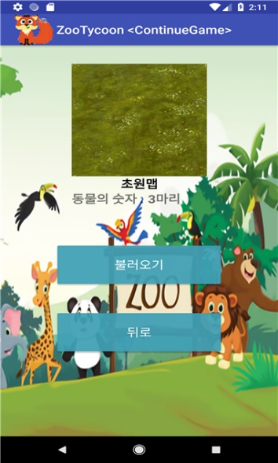

# Zoo Tycoon

An Android game where you build a zoo by dragging animals and zookeepers onto a grassland. The placed animals are saved in SQLite, so the zoo can be loaded and continued later.

<p>
  
</p>


## How to play

Open `source/` in Android Studio and build it. The project uses Android Gradle plugin 3.1.3, Gradle 4.4, and `compileSdkVersion 28`, with a `minSdkVersion` of 22 (Android 5.1).

On the loading screen, touch the screen once "계속하려면 화면을 터치하세요." (touch the screen to continue) appears after 3 seconds. On the main screen, "불러오기" (load) shows the number of saved animals and then continues, and "도움말" (help) describes the animals and zookeepers. The "새로 만들기" (new) screen lets you choose whether zookeepers can be hired and a game speed of up to 3 stars, and pressing "새로 만들기" there empties the saved zoo and starts. The faster the game speed, the faster the animals bob in place.

| Control | Action |
|---|---|
| Long press an animal or zookeeper in the bottom bar and drag it | Places it where it is dropped |
| Long press a placed animal | Sends it back to the wild |
| Drag the grassland | Looks around the map |

The animals are a penguin, a crocodile, a deer, a fox, a koala, a squirrel, and a turtle, and the 3 zookeepers handle training, feeding, and cleaning. Zookeepers can be placed in games where "사육사 고용" (hire zookeepers) is turned on.


## How it works

**Placement uses Android drag and drop and is written to SQLite right away.** A long press on a picture in the bottom bar starts a drag with a `ClipData` that carries the ID of that view. On `ACTION_DROP`, the map layout creates a new `ImageView` with the picture of that ID at the drop position, and at the same moment inserts a row with the view ID and the position into the `animals` table. The loading screen reads this table into a list in memory, and the game places everything in the list again when it starts.

```java
case DragEvent.ACTION_DROP:
    int viewId = event.getClipData().getItemAt(0).getIntent().getIntExtra("Id", -1);
    createAnimal(viewId, event.getX(), event.getY());
    ZooTycoonDB.addAnimal(new ZooTycoonDB.Animal(viewId, (int) event.getX(), (int) event.getY()));
    return true;
```

**The map pushes two scroll views together.** The grassland, a 3x3 tiling of a 512dp grass texture, sits in a `HorizontalScrollView` inside a `ScrollView`. `SyncScroll` takes the touches of both views and calls `scrollBy` on the horizontal and vertical one at the same time by the distance the finger moved, so the map can also be dragged diagonally.


## Files

| Path | Content |
|---|---|
| `source/app/src/main/java/com/jungu/zootycoon/GameActivity.java` | Game screen and drag and drop placement |
| `source/app/src/main/java/com/jungu/zootycoon/ZooTycoonDB.java`, `ZooTycoonHelper.java` | Saving to and loading from SQLite |
| `source/app/src/main/java/com/jungu/zootycoon/SyncScroll.java` | Map scrolling |
| Other activities in `source/app/src/main/java/com/jungu/zootycoon/` | Loading, main, new game, load, and help screens |
| `source/app/src/main/res/` | Layouts, pictures, and animations |
| `docs/screenshots/` | Screenshots |


## License

CC BY-NC-ND 4.0. Unmodified copies may be shared for noncommercial purposes with attribution. Modified versions and commercial use are not allowed. Bundled libraries, graphics, sounds, and maps made by other people keep their own rights. See [LICENSE](LICENSE).
